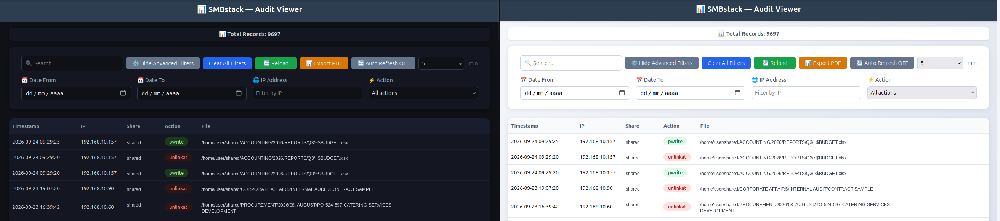
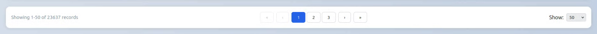
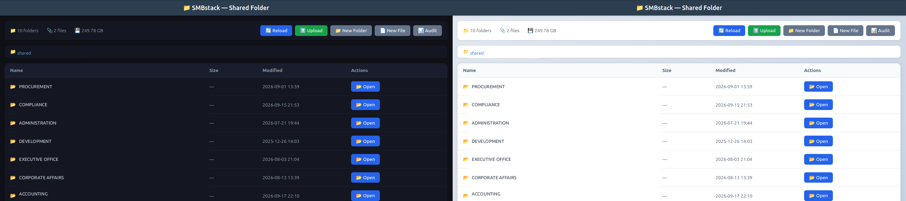
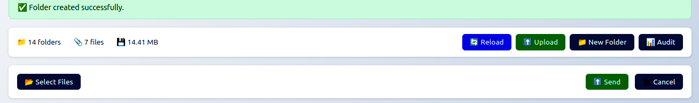
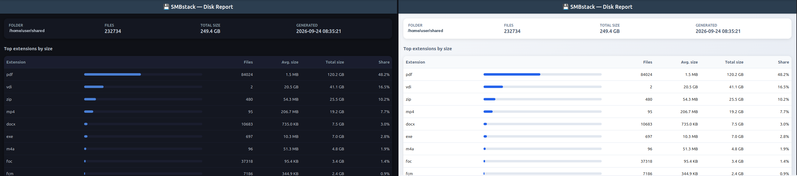

<!--
SMBstack documentation
FILE: README.md
-->
# [SMBstack](https://github.com/maravento) — Samba Server Stack

[](https://github.com/maravento/smbstack)
[](https://github.com/maravento/smbstack)
[](https://github.com/maravento/smbstack/stargazers)
[](https://twitter.com/maraventostudio)

<table width="100%">
  <tr>
    <td style="width: 50%; vertical-align: top;">
      <p>Many small and medium-sized businesses need to share files on their local network. They may also need to recover deleted files, review access records, manage files through a browser and control storage usage. Dedicated NAS devices often provide these functions, but their cost can be a barrier in some environments.</p>
      <p>One alternative is to use <strong>Samba</strong> on Linux. A standard installation lets you share files and folders; additional components are needed for the other functions.</p>
      <p><strong>SMBstack</strong> provides part of this infrastructure using <strong>Samba</strong> on Ubuntu as its base.</p>
      <p><strong>Samba</strong> remains responsible for file sharing and permission management. <strong>SMBstack</strong> adds a recycle bin with separate channels for each source, audit logging through <code>rsyslog</code>, a web panel with three views and a daily disk usage report.</p>
      <p>In the background, <code>smbload</code> monitors the services, <code>smbwatch</code> enforces folder size limits and <code>smbbk</code> backs up the configuration.</p>
    </td>
    <td style="width: 50%; vertical-align: top;">
      <p>Muchas pequeñas y medianas empresas necesitan compartir archivos en su red local. Además, pueden necesitar recuperar archivos eliminados, consultar los accesos, gestionar archivos desde un navegador y controlar el espacio utilizado. Estas funciones suelen ofrecerse en dispositivos NAS, cuyo costo puede ser una barrera en algunos entornos.</p>
      <p>Una alternativa es usar <strong>Samba</strong> en Linux. La instalación estándar permite compartir archivos y carpetas; para añadir las demás funciones se necesitan componentes adicionales.</p>
      <p><strong>SMBstack</strong> proporciona parte de esta infraestructura utilizando <strong>Samba</strong> sobre Ubuntu como base.</p>
      <p><strong>Samba</strong> sigue a cargo de compartir archivos y gestionar permisos. <strong>SMBstack</strong> añade una papelera con canales separados según el origen de los archivos, auditoría mediante <code>rsyslog</code>, un panel web con tres vistas y un informe diario de uso de disco.</p>
      <p>En segundo plano, <code>smbload</code> supervisa los servicios, <code>smbwatch</code> controla el tamaño de las carpetas y <code>smbbk</code> crea respaldos de la configuración.</p>
    </td>
  </tr>
</table>

<!-- markdownlint-disable MD033 -->

## REQUIREMENTS

---

<table width="100%">
  <tr>
    <td style="width: 50%; vertical-align: top;">
      <p>Only tested on Ubuntu 24.04/26.04 LTS. Other versions or distributions are not tested and are used at your own risk.</p>
    </td>
    <td style="width: 50%; vertical-align: top;">
      <p>Solo probado en Ubuntu 24.04/26.04 LTS. Otras versiones o distribuciones no están probadas y se usan bajo tu responsabilidad.</p>
    </td>
  </tr>
</table>

- Apache2 and PHP (`apache2`, `apache2-utils`, `libapache2-mod-php`, `php`)
- `rsyslog`, `logrotate`
- `acl`, `openssl`, `cron`, `iproute2`, `sudo`, `systemd`, `util-linux`, `zip` (checked by `smbsetup.sh`)
- `inotify-tools`, `procps`, `coreutils`, `findutils`, `cron`, `util-linux`, `sed`, `grep` (checked by `tools/smbwatch.sh`)
- `procps`, `samba`, `winbind`, `util-linux`, `coreutils`, `sed`, `systemd` (checked by `tools/smbload.sh`)
- `zip`, `coreutils`, `util-linux`, `cron` (checked by `tools/smbbk.sh`)
- `findutils`, `coreutils`, `util-linux`, `cron`, `php-cli` (checked by `tools/smbreport.sh`)

```bash
apt-get install -y apache2 apache2-utils libapache2-mod-php php rsyslog logrotate \
    acl openssl cron iproute2 sudo systemd util-linux sed grep inotify-tools \
    procps coreutils findutils zip
```

The Samba packages (`samba`, `samba-common`, `samba-common-bin`, `smbclient`, `winbind`, `cifs-utils`) are installed by `smbsetup.sh` itself.

<table width="100%">
  <tr>
    <td style="width: 50%; vertical-align: top;">
      <strong>Important</strong>
      <ul>
        <li>The installer aborts if <code>nginx</code>, <code>lighttpd</code>, <code>caddy</code>, <code>ksmbd-tools</code> or <code>syslog-ng</code> are installed.</li>
        <li>The web panel listens on port <code>3092</code>, registered by <a href="https://www.iana.org/assignments/service-names-port-numbers/service-names-port-numbers.txt">IANA</a> as Unassigned.</li>
      </ul>
    </td>
    <td style="width: 50%; vertical-align: top;">
      <strong>Importante</strong>
      <ul>
        <li>El instalador aborta si <code>nginx</code>, <code>lighttpd</code>, <code>caddy</code>, <code>ksmbd-tools</code> o <code>syslog-ng</code> están instalados.</li>
        <li>El panel web escucha en el puerto <code>3092</code>, registrado por <a href="https://www.iana.org/assignments/service-names-port-numbers/service-names-port-numbers.txt">IANA</a> como Sin asignar.</li>
      </ul>
    </td>
  </tr>
</table>

## REPOSITORY STRUCTURE

---

```
smbstack/
├── acl/                         # Static access-control lists for Samba
│   └── commonveto.txt              # Veto list for common unwanted file types (active by default in smb.conf)
│
├── conf/                        # Samba, rsyslog and Apache configuration
│   ├── fullaudit.conf              # rsyslog full audit rule
│   ├── smb.conf                    # Samba main config (placeholders: your_user, compartida)
│   └── smbweb.conf                 # Apache vhost (:3092/?tab=shared, ?tab=audit and ?tab=report)
│
├── tools/                      # Background watchdog and maintenance scripts
│   ├── smbstackenv.sh              # Shared Bash configuration reader (sourced, not executed)
│   ├── smbbk.sh                    # Configuration backup for smbstack
│   ├── smbload.sh                  # Service watchdog (smbd + winbind + smbwatch)
│   ├── smbreport.sh                # Disk usage report for the shared folder (daily cron)
│   └── smbwatch.sh                 # Shared folder size monitor (self-managed)
│
├── web/                        # Web front-end: shared-folder browser, audit log viewer and disk report
│   ├── icon.svg                    # PWA / apple-touch icon
│   ├── index.php                   # Main page (Shared / Audit / Report tabs)
│   ├── manifest.json               # PWA manifest
│   ├── smbshared.php               # Shared folder dynamic browser
│   ├── smbapi.php                  # Audit log and disk report reader API
│   ├── smbaudit-diagnostic.php     # Audit log diagnostic tool
│   ├── smbaudit.html               # Audit log viewer UI
│   ├── smbreport.html              # Disk report viewer UI
│   └── sw.js                       # PWA service worker (app-shell cache only)
│
└── smbsetup.sh                 # Installer: install, update, uninstall, status
```

<table width="100%">
  <tr>
    <td style="width: 50%; vertical-align: top;">
      Files and directories generated at runtime (not included in the repository):
    </td>
    <td style="width: 50%; vertical-align: top;">
      Archivos y directorios generados en runtime (no incluidos en el repositorio):
    </td>
  </tr>
</table>

```
/var/www/smbstack/
├── .size_cache/                # Folder size cache used by smbshared.php (www-data, pruned daily by cron)
└── web/                        # Deployed copy of web/ (served by Apache on :3092)
    └── smbreport.json          # Disk report written by tools/smbreport.sh (root:www-data, 640)

/etc/smbstack/
├── acl/                        # Deployed copy of acl/ (root:root, 644)
│   └── commonveto.txt          # Veto list included by smb.conf
├── tools/                      # Deployed tools (root:root, 755); smbstackenv.sh is 644
└── smbstack.env                # Saved install config (user, paths, network, trusted proxies, watch limit, max log lines)

/etc/bak/smbstack/              # Archives written by tools/smbbk.sh (smbbk_<YYYYMMDD_HHMMSS>.zip, last 3 kept),
                                # run by --update before overwriting application code, and by its own monthly cron
/etc/cron.d/smbstack            # All cron entries of the project, one file

/var/log/smbwatch.log           # smbwatch.sh runtime log (root:root, 640)
/var/log/smbload.log            # smbload.sh runtime log, rewritten on each run
/var/log/smbstack.log           # smbbk.sh and smbreport.sh runtime log, shared
smbsetup.log                    # In smbsetup.sh's own directory, rewritten on each run

/home/$local_user/shared/       # Shared folder (independent of the installer)
├── .recycle/                   # Recycle Bin (smbguest/, www-data/, smbwatch/)
└── DEMO/                       # Demo folder

/etc/logrotate.d/samba          # Generated by installer (heredoc)
/etc/logrotate.d/smbwatch       # Generated by installer (heredoc), rotates /var/log/smbwatch.log
/var/log/samba/log.audit        # Created by rsyslog
/var/log/samba/log.samba        # Created by installer, written directly by smbd
```

## HOW TO USE

---

```bash
git clone --depth=1 https://github.com/maravento/smbstack.git
cd smbstack

# Install
sudo bash smbsetup.sh --install

# Update
sudo bash smbsetup.sh --update

# Uninstall
sudo bash smbsetup.sh --uninstall

# Status
sudo bash smbsetup.sh --status

# Interactive menu
sudo bash smbsetup.sh
```

## SCOPE

---

| SCOPE | ALCANCE |
|---|---|
| <ul> <li>Installs and configures Samba with a shared folder, recycle bin and group permissions.</li> <li>Configures audit logging through <code>rsyslog</code> to <code>/var/log/samba/log.audit</code>.</li> <li>Deploys a web panel with three tabs at <code>http://localhost:3092/</code>: shared folder, audit log and disk usage report.</li> <li>Configures <code>logrotate</code> for the Samba logs.</li> <li>Installs the <code>smbload.sh</code> service monitor, which cron runs every five minutes.</li> <li>Includes <code>smbwatch.sh</code>, a shared folder size monitor managed separately from the installer.</li> <li>Provides a configuration backup tool (<code>smbbk.sh</code>), run through cron monthly.</li> <li>Installs a disk usage report (<code>smbreport.sh</code>), run through cron daily at 03:00.</li> <li>Saves the installation configuration to <code>/etc/smbstack/smbstack.env</code> for future updates.</li> <li>Keeps NetBIOS disabled by default. It can be enabled manually if required; see the NetBIOS section.</li> </ul> | <ul> <li>Instala y configura Samba con una carpeta compartida, papelera de reciclaje y permisos de grupo.</li> <li>Configura la auditoría mediante <code>rsyslog</code> en <code>/var/log/samba/log.audit</code>.</li> <li>Despliega un panel web con tres pestañas en <code>http://localhost:3092/</code>: carpeta compartida, registro de auditoría e informe de uso de disco.</li> <li>Configura <code>logrotate</code> para los registros de Samba.</li> <li>Instala el supervisor de servicios <code>smbload.sh</code>, que cron ejecuta cada cinco minutos.</li> <li>Incluye <code>smbwatch.sh</code>, un monitor de espacio que se administra por separado y no depende del instalador.</li> <li>Proporciona una herramienta de respaldo de configuración (<code>smbbk.sh</code>), ejecutada mediante cron mensualmente.</li> <li>Instala un informe de uso de disco (<code>smbreport.sh</code>), ejecutado mediante cron diariamente a las 03:00.</li> <li>Guarda la configuración de la instalación en <code>/etc/smbstack/smbstack.env</code> para futuras actualizaciones.</li> <li>Mantiene NetBIOS deshabilitado por defecto. Puede activarse manualmente si es necesario; consulte la sección NetBIOS.</li> </ul> |
| **OUT OF SCOPE** | **FUERA DE ALCANCE** |
| <ul> <li>Active Directory / domain controller.</li> <li>Multiple shared folders.</li> <li>Custom paths outside <code>/home/$local_user/</code> (require manual editing).</li> <li>IPv6.</li> <li>LDAP.</li> </ul> | <ul> <li>Active Directory / controlador de dominio.</li> <li>Múltiples carpetas compartidas.</li> <li>Rutas personalizadas fuera de <code>/home/$local_user/</code> (requieren edición manual).</li> <li>IPv6.</li> <li>LDAP.</li> </ul> |

## HOW IT WORKS

---

### Update checks

| Step | Description | Descripción |
|---|---|---|
| Before copying | The installer checks all required source files and destinations, write access, available space, immutable attributes and relevant locks. | El instalador comprueba todos los orígenes y destinos, escritura, espacio disponible, atributos inmutables y bloqueos relevantes. |
| Backup | The installer invokes `smbbk.sh`. If `smbbk.sh` fails, the installer aborts before pausing consumers or replacing files, without writing `done`. | El instalador invoca `smbbk.sh`. Si `smbbk.sh` falla, el instalador aborta antes de pausar procesos o reemplazar archivos, sin escribir `done`. |
| Pause | The installer pauses its cron file and stops affected services and daemons. It verifies they have stopped and waits for running jobs before replacing files. If a pause fails before any replacement, the installer attempts to resume the previous consumers and schedule. | El instalador pausa su archivo cron y detiene los servicios y demonios afectados. Comprueba su detención y espera que terminen las tareas en ejecución antes de reemplazar archivos. Si falla una pausa antes de reemplazar archivos, el instalador intenta reanudar los procesos y la programación anteriores. |
| Copy | The installer repeats the checks immediately before copying. It verifies every replacement and its file contents. If a replacement fails, it aborts without `done`; it does not resume the consumers or restore the backup. The paused schedule remains at `/etc/cron.d/smbstack.update-disabled`. | El instalador repite las comprobaciones inmediatamente antes de copiar. Comprueba cada reemplazo y el contenido copiado. Si falla un reemplazo, aborta sin `done`; no reanuda los procesos ni restaura el respaldo. La programación pausada permanece en `/etc/cron.d/smbstack.update-disabled`. |
| Finish | The installer regenerates its complete cron file and resumes the consumers that were active. It writes `done` only after successful completion. | El instalador regenera su archivo cron completo y reanuda los procesos que estaban activos. Escribe `done` únicamente si termina correctamente. |

### Installer behavior

<table width="100%">
  <tr>
    <td style="width: 50%; vertical-align: top;">
      When several interfaces are available, select the LAN interface from the list. Installation aborts with <code>ERROR: ... -abort</code> if the selected LAN has no configured IPv4 address. Select an address when several exist. The network and mask come from that address and its actual prefix. These installers do not configure network interfaces. Explicit interface/address values supplied by a parent installer reuse its selection.
    </td>
    <td style="width: 50%; vertical-align: top;">
      Si existen varias interfaces, selecciona LAN desde la lista. La instalación aborta con <code>ERROR: ... -abort</code> si LAN no tiene IPv4 configurada. Selecciona una dirección cuando existan varias. La red y máscara proceden de esa dirección y su prefijo real. Estos instaladores no configuran interfaces. Los valores explícitos enviados por otro instalador reutilizan su selección.
    </td>
  </tr>
</table>

<table width="100%">
  <tr>
    <td style="width: 50%; vertical-align: top;">
      The installer will prompt for:
    </td>
    <td style="width: 50%; vertical-align: top;">
      El instalador preguntará por:
    </td>
  </tr>
</table>

| Prompt | Description | Descripción |
|--------|-------------|-------------|
| Shared folder name | Name for the shared folder (created under `/home/$local_user/`) | Nombre de la carpeta compartida (creada bajo `/home/$local_user/`) |
| Network interface | Selected from available interfaces listed. The Samba network is derived from its address and prefix | Seleccionada de las interfaces disponibles listadas. La red de Samba se deriva de su dirección y prefijo |
| Samba password | Password for the automatically detected account | Contraseña de la cuenta detectada automáticamente |
| Overwrite smb.conf | Only asked if `/etc/samba/smb.conf` already exists | Solo se pregunta si `/etc/samba/smb.conf` ya existe |

> To use a shared folder located outside `/home/$local_user/`, edit `/etc/samba/smb.conf` and `/etc/apache2/sites-available/smbweb.conf` manually after the installation.
>
> Para utilizar una carpeta compartida ubicada fuera de `/home/$local_user/`, edita manualmente `/etc/samba/smb.conf` y `/etc/apache2/sites-available/smbweb.conf` después de la instalación.

#### Interface

| Description | Descripción |
|---|---|
| Set `SMBSTACK_IFACE` to skip the interactive interface selection. For example:<br><br>`sudo SMBSTACK_IFACE=eth1 bash smbsetup.sh --install`<br><br>Another installer deploying SMBstack can use this variable to provide the interface it already knows.<br><br>`$local_user` is the local Linux user that the installer detects automatically.<br><br>The installer looks for an account whose UID falls within the range in `/etc/login.defs`, whose login shell is enabled and that belongs to the `sudo` group. If several accounts match, it selects the one with the lowest UID.<br><br>That account owns the shared folder and provides the base name for the Samba username. | Define `SMBSTACK_IFACE` para omitir la selección interactiva de la interfaz. Por ejemplo:<br><br>`sudo SMBSTACK_IFACE=eth1 bash smbsetup.sh --install`<br><br>Otro instalador que despliega SMBstack puede utilizar esta variable para proporcionar la interfaz que ya conoce.<br><br>`$local_user` es el usuario local de Linux que el instalador detecta automáticamente.<br><br>El instalador busca una cuenta con UID dentro del rango de `/etc/login.defs`, una shell habilitada y pertenencia al grupo `sudo`. Si encuentra varias, elige la de UID más bajo.<br><br>Usa esa cuenta como propietaria de la carpeta compartida y como base para el nombre de usuario de Samba. |

#### Updated and removed files

| File | `--update` | `--uninstall` |
|------|-----------|---------------|
| `conf/smb.conf` | ⛔ not touched (user-customized) | ✅ restored from `.bak` if it exists (only created when the installer overwrote a pre-existing `smb.conf`; on a fresh install, no `.bak` exists and `smb.conf` is left untouched) |
| `conf/fullaudit.conf` | ⛔ not touched (user-customized) | ✅ removed |
| `conf/smbweb.conf` | ⛔ not touched (user-customized) | ✅ removed |
| `web/index.php` | ✅ overwritten | ✅ removed |
| `web/smbaudit.html` | ✅ overwritten | ✅ removed |
| `web/smbapi.php` | ✅ overwritten | ✅ removed |
| `web/smbaudit-diagnostic.php` | ✅ overwritten | ✅ removed |
| `web/smbshared.php` | ✅ overwritten | ✅ removed |
| `web/manifest.json` | ✅ overwritten | ✅ removed |
| `web/sw.js` | ✅ overwritten | ✅ removed |
| `web/icon.svg` | ✅ overwritten | ✅ removed |
| `tools/smbbk.sh` | ✅ overwritten | ✅ removed (its cron entry is deregistered first) |
| `tools/smbload.sh` | ✅ overwritten | ✅ removed |
| `tools/smbreport.sh` | ✅ overwritten | ✅ removed (its cron entry is deregistered first) |
| `tools/smbwatch.sh` | ✅ overwritten | ✅ removed |
| `/etc/smbstack/smbstack.env` | ⛔ preserved | ✅ removed |
| Shared folder (`/home/$local_user/shared/`) | ⛔ never touched | ⛔ never touched |

> The shared folder is independent of the installer. To remove it, do so manually: `rm -rf /home/$local_user/shared`
>
> La carpeta compartida es independiente del instalador. Para eliminarla, hazlo manualmente: `rm -rf /home/$local_user/shared`

#### Backup

| Description | Descripción |
|---|---|
| Before updating files, `--update` runs `tools/smbbk.sh`, which saves a backup in `/etc/bak/smbstack`.<br><br>It only updates the application code: the web viewers in PHP and HTML and `tools/*.sh`.<br><br>The configuration files deployed during the installation, `smb.conf`, `fullaudit.conf` and `smbweb.conf`, are never overwritten, since they may contain manual edits such as custom shares, `hosts allow` or interfaces.<br><br>To incorporate changes to those files after an update, compare them with the versions in `conf/` in the repository, then apply the ones you need manually. | Antes de actualizar los archivos, `--update` ejecuta `tools/smbbk.sh`, que guarda un respaldo en `/etc/bak/smbstack`.<br><br>Solo actualiza el código de la aplicación: los visores web en PHP y HTML y `tools/*.sh`.<br><br>Los archivos de configuración desplegados en la instalación, `smb.conf`, `fullaudit.conf` y `smbweb.conf`, nunca se sobrescriben, ya que pueden contener ediciones manuales como shares personalizados, `hosts allow` o interfaces.<br><br>Para incorporar cambios en esos archivos después de actualizar, compáralos con las versiones de `conf/` del repositorio y aplica manualmente los que necesites. |

### Status

<table width="100%">
  <tr>
    <td style="width: 50%; vertical-align: top;">
      Shows the status of the <code>smbd</code> and <code>winbind</code> services, the status of Apache port <code>3092</code>, the last five audit log entries and a <code>testparm</code> summary.
    </td>
    <td style="width: 50%; vertical-align: top;">
      Muestra el estado de los servicios <code>smbd</code> y <code>winbind</code>, el estado del puerto <code>3092</code> de Apache, las últimas cinco entradas del registro de auditoría y un resumen de <code>testparm</code>.
    </td>
  </tr>
</table>

```bash
sudo bash smbsetup.sh --status
```

### smbstackenv.sh

<table width="100%">
  <tr>
    <td style="width: 50%; vertical-align: top;">
      Shared Bash reader installed at <code>/etc/smbstack/tools/smbstackenv.sh</code> (root:root, 644). <code>smbsetup.sh</code>, <code>smbbk.sh</code>, <code>smbreport.sh</code> and <code>smbwatch.sh</code> load it with <code>source</code> and declare their allowed keys. It parses <code>smbstack.env</code> without executing it; file permissions and key validation remain with each caller. Installation and update deploy it before consumers; the backup and report tools also copy it when registering themselves. Do not run it separately or schedule it in cron.
    </td>
    <td style="width: 50%; vertical-align: top;">
      Lector Bash compartido instalado en <code>/etc/smbstack/tools/smbstackenv.sh</code> (root:root, 644). <code>smbsetup.sh</code>, <code>smbbk.sh</code>, <code>smbreport.sh</code> y <code>smbwatch.sh</code> lo cargan mediante <code>source</code> y declaran sus claves permitidas. Interpreta <code>smbstack.env</code> sin ejecutarlo; los permisos y la validación de claves permanecen en cada script. La instalación y la actualización despliegan el lector antes de sus consumidores; las herramientas de respaldo e informes también lo copian cuando se registran. No se ejecuta por separado ni se programa en cron.
    </td>
  </tr>
</table>

### Config

<table width="100%">
  <tr>
    <td style="width: 50%; vertical-align: top;">
      After installation, the main configuration files are:
    </td>
    <td style="width: 50%; vertical-align: top;">
      Tras la instalación, los archivos de configuración principales son:
    </td>
  </tr>
</table>

| Description | File |
|-------------|------|
| Samba main config | `/etc/samba/smb.conf` |
| Audit rsyslog rule | `/etc/rsyslog.d/fullaudit.conf` |
| Web vhost (audit + shared) | `/etc/apache2/sites-available/smbweb.conf` |
| Log rotation (Samba logs) | `/etc/logrotate.d/samba` |
| Log rotation (`smbwatch.sh`) | `/etc/logrotate.d/smbwatch` |
| Log rotation (Apache logs, set to `rotate 7`) | `/etc/logrotate.d/apache2` |
| Install config | `/etc/smbstack/smbstack.env` |

#### smbstack.env keys

<table width="100%">
  <tr>
    <td style="width: 50%; vertical-align: top;">
      <code>smbsetup.sh</code> writes the nine keys below during <strong>install</strong> and never overwrites the file on <strong>update</strong>. <code>smbwatch.sh --install</code> adds two more of its own, <code>WATCH_LIMIT_GB</code> and <code>WATCH_EXCLUDE</code>; see the smbwatch section.
    </td>
    <td style="width: 50%; vertical-align: top;">
      <code>smbsetup.sh</code> escribe las nueve claves de abajo durante <strong>install</strong> y no sobrescribe el archivo en <strong>update</strong>. <code>smbwatch.sh --install</code> añade dos propias, <code>WATCH_LIMIT_GB</code> y <code>WATCH_EXCLUDE</code>; ver la sección de smbwatch.
    </td>
  </tr>
</table>

| Variable | Read by | Description | Descripción |
|----------|---------|--------------|-------------|
| `LOCAL_USER` | `smbbk.sh` | Non-root local user that owns the shared folder. The backups belong to `root`, so `smbbk.sh` only reads this account's `passwd` entry to record it | Usuario local sin privilegios que posee la carpeta compartida. Las copias pertenecen a `root`, así que `smbbk.sh` solo lee la entrada `passwd` de esta cuenta para registrarla |
| `SHARED_NAME` | `smbshared.php` | Share name as the SMB clients see it | Nombre del recurso tal como lo ven los clientes SMB |
| `SHARED_PATH` | `smbwatch.sh`, `smbreport.sh`, `smbshared.php` | Absolute path of the shared folder | Ruta absoluta de la carpeta compartida |
| `SMB_NET` | `smbsetup.sh` | LAN subnet in CIDR form allowed to reach the share | Subred LAN en formato CIDR autorizada a acceder al recurso |
| `SMB_IFACE` | `smbsetup.sh` | Interface Samba binds to | Interfaz a la que se enlaza Samba |
| `SERVER_IP` | `smbsetup.sh`, `smbshared.php` | Server's own IPv4 on that interface | IPv4 del servidor en esa interfaz |
| `SMBNAME` | `smbsetup.sh` | Samba account created for the share | Cuenta de Samba creada para el recurso |
| `SMBREPORT_TOP_ROWS`, `SMBREPORT_TOP_FILES` | `smbreport.sh` | Report ranking limits. Defaults: `30` rows and `50` files, written automatically without questions. Positive integers without leading zeros. Changing these defaults is not recommended. | Límites de los listados del informe. Valores iniciales: `30` filas y `50` archivos, escritos automáticamente sin preguntas. Enteros positivos sin ceros iniciales. No se recomienda modificarlos. |
| `MAX_LOG_LINES` | `smbapi.php`, `smbaudit-diagnostic.php` | Maximum lines read from the current audit log per request; default `50000`. The audit viewer's own request uses a fixed limit in its JavaScript, so raising this does not change what the UI asks for | Máximo de líneas que se leen del log de auditoría vigente por petición; valor predeterminado `50000`. La petición del visor usa un límite fijo en su JavaScript, así que subir esta clave no cambia lo que pide la interfaz |
| `TRUSTED_PROXIES` | `smbshared.php` | IPv4 addresses, comma-separated, whose `REMOTE_ADDR` is trusted to carry the real client IP in a header; default `127.0.0.1` | Direcciones IPv4 separadas por comas cuyo `REMOTE_ADDR` se considera fiable para traer la IP real del cliente en un encabezado; valor predeterminado `127.0.0.1` |

#### Trusted proxies

| Description | Descripción |
|---|---|
| `smbstack.env` sets `TRUSTED_PROXIES="127.0.0.1"` by default.<br><br>This setting tells `web/smbshared.php` that, for requests arriving from `localhost`, it must use the `CF-Connecting-IP` or `X-Forwarded-For` header, when present, instead of `REMOTE_ADDR`. This way the loopback connection of a local tunnel is not recorded as the client address in the audit log.<br><br>The setting has no effect on direct access from the LAN. | `smbstack.env` establece `TRUSTED_PROXIES="127.0.0.1"` por defecto.<br><br>Esta configuración indica a `web/smbshared.php` que, para las solicitudes que llegan desde `localhost`, utilice el encabezado `CF-Connecting-IP` o `X-Forwarded-For`, cuando esté presente, en lugar de `REMOTE_ADDR`. De esta forma, la conexión loopback de un túnel local no se registra como la dirección del cliente en el registro de auditoría.<br><br>La configuración no tiene efecto sobre el acceso directo desde la LAN. |

#### Quick commands

```bash
# Verify Samba config | Verificar configuración de Samba
testparm

# Restart services | Reiniciar servicios
sudo systemctl restart smbd winbind

# View audit log | Ver log de auditoría
tail -f /var/log/samba/log.audit

# List Samba users | Listar usuarios de Samba
sudo pdbedit -L
```

### Recycle Bin

| Description | Descripción |
|---|---|
| SMBstack uses the Samba `vfs_recycle` module to redirect deleted files to a hidden recycle bin, instead of removing them permanently. The bin is stored inside the shared folder, under `.recycle/`. | SMBstack utiliza el módulo `vfs_recycle` de Samba para redirigir los archivos eliminados a una papelera de reciclaje oculta, en lugar de borrarlos permanentemente. Esta se almacena dentro de la carpeta compartida, en `.recycle/`. |

#### Recycle bin channels

<table width="100%">
  <tr>
    <td style="width: 50%; vertical-align: top;">
      SMBstack uses three independent channels to write to the recycle bin, each running under a different system context:
    </td>
    <td style="width: 50%; vertical-align: top;">
      SMBstack utiliza tres canales independientes para escribir en la papelera de reciclaje, cada uno ejecutándose bajo un contexto de sistema diferente:
    </td>
  </tr>
</table>

| Path | Written by | Purpose | Propósito |
|---|---|---|---|
| `.recycle/smbguest/` | SMB clients on the LAN, through `vfs_recycle` (`smbguest`, set by `force user` in `smb.conf`) | Holds files deleted by users from Windows or Linux over the network | Guarda los archivos borrados por los usuarios desde Windows o Linux por la red |
| `.recycle/www-data/` | The web interface running under Apache (`www-data`) | Holds files deleted from the browser panel | Guarda los archivos borrados desde el panel web |
| `.recycle/smbwatch/` | `tools/smbwatch.sh` (`root:root`) | Holds files moved out automatically when a monitored folder exceeds its size limit | Guarda los archivos retirados automáticamente cuando una carpeta monitoreada supera su límite de tamaño |

<table width="100%">
  <tr>
    <td style="width: 50%; vertical-align: top;">
      This is why the recycle bin directory contains one subdirectory per channel:
    </td>
    <td style="width: 50%; vertical-align: top;">
      Por eso el directorio de la papelera contiene un subdirectorio por canal:
    </td>
  </tr>
</table>

```
.recycle/
├── smbguest/               # Files deleted by Windows/Linux SMB clients on the LAN
│   └── DOCUMENTS/
│       ├── report.docx
│       └── Copy #1 of report.docx
├── www-data/               # Files deleted via the web browser interface
│   └── 20260623/
│       └── invoice.pdf
└── smbwatch/               # Files auto-moved by the size-limit watchdog
    └── 20260711/
        └── bigfile.iso
```

> the recycle bin lives inside the shared folder itself, so that recycling a file is a `mv` within the same filesystem: instantaneous and without copying data, something that would not happen if the bin were on another disk. For the details of each channel, see the *Web Interface*, *smbwatch* and *Configuration reference* sections.
>
> la papelera vive dentro de la propia carpeta compartida para que reciclar un archivo sea un `mv` dentro del mismo sistema de archivos: instantáneo y sin copiar datos, algo que no ocurriría si la papelera estuviera en otro disco. Para conocer el detalle de cada canal, consulta las secciones *Web Interface*, *smbwatch* y *Configuration reference*.

#### Recycle timestamp

<table width="100%">
  <tr>
    <td style="width: 50%; vertical-align: top;">
      The weekly cleanup deletes items based on their modification date. Each channel therefore updates that date when moving an item to the recycle bin. Otherwise, an old file could be deleted during the next cleanup even though it had only just been recycled.<br><br>Each channel updates the item's modification date with the current date when moving it to the bin:
    </td>
    <td style="width: 50%; vertical-align: top;">
      La limpieza semanal elimina elementos según su fecha de modificación. Por eso, al mover un archivo a la papelera, cada canal actualiza esa fecha. Si se conservara la fecha original, un archivo antiguo podría eliminarse en la siguiente limpieza aunque acabara de reciclarse.<br><br>Cada canal actualiza la fecha de modificación del elemento con la fecha actual al moverlo a la papelera:
    </td>
  </tr>
</table>

| Channel | Stamped by |
|---------|------------|
| SMB (LAN clients) | `recycle:touch = yes` in `smb.conf` |
| Web interface (Apache) | `recycle_touch()` in `web/smbshared.php`, applied recursively so a recycled folder carries its contents |
| Size-limit watchdog | `touch` after the move, in `tools/smbwatch.sh` |

> A restored item therefore carries the date it was recycled, not its original one.
>
> Por eso un elemento restaurado conserva la fecha en que fue reciclado, no la original.

#### File versioning

<table width="100%">
  <tr>
    <td style="width: 50%; vertical-align: top;">
      When <code>recycle:versions = yes</code> is active, deleting a file that already exists in the recycle bin does not overwrite it. The new copy is kept alongside the original with the <code>Copy #N of</code> prefix:
    </td>
    <td style="width: 50%; vertical-align: top;">
      Cuando <code>recycle:versions = yes</code> está activo, eliminar un archivo que ya existe en la papelera no lo sobrescribe. La nueva copia se conserva junto a la original con el prefijo <code>Copy #N of</code>:
    </td>
  </tr>
</table>

```
.recycle/smbguest/DOCUMENTS/
├── report.docx             ← first deletion
└── Copy #1 of report.docx  ← second deletion of the same file
```

<table width="100%">
  <tr>
    <td style="width: 50%; vertical-align: top;">
      To exclude specific file types from versioning, use <code>recycle:noversions</code>. These types are still recycled, but repeated deletions <strong>overwrite</strong> the previous copy in the bin rather than creating a numbered duplicate:
    </td>
    <td style="width: 50%; vertical-align: top;">
      Para excluir tipos de archivo del versionado, usa <code>recycle:noversions</code>. Estos archivos siguen yendo a la papelera, pero eliminaciones repetidas <strong>sobreescriben</strong> la copia anterior en lugar de crear una nueva numerada:
    </td>
  </tr>
</table>

```ini
# All files keep multiple versions:
recycle:versions = yes

# These types are recycled but NOT versioned — second delete overwrites the first:
recycle:noversions = *.dat,*.ini
```

> Use `noversions` for files where accumulating copies adds no value: runtime data files, config dumps, ini snapshots, and similar.
>
> Usa `noversions` para archivos donde acumular copias no aporta valor: archivos de datos en tiempo de ejecución, volcados de configuración, snapshots de ini y similares.

#### Configuration reference

| Parameter | Value | Purpose | Propósito |
|-----------|-------|---------|-----------|
| `recycle:repository` | `.recycle/%U` | SMB channel recycle bin, resolves to `smbguest` | Papelera del canal SMB, resuelve a `smbguest` |
| `recycle:directory_mode` | `0775` | Group-writable recycle directory | Directorio escribible por el grupo |
| `recycle:keeptree` | `yes` | Preserve original folder structure | Preservar estructura de carpetas |
| `recycle:versions` | `yes` | Keep multiple versions of deleted files | Mantener múltiples versiones |
| `recycle:noversions` | `*.dat,*.ini` | Exclude patterns from versioning | Excluir patrones del versionado |
| `recycle:touch` | `yes` | Update access time when recycled | Actualizar tiempo de acceso al reciclar |
| `recycle:exclude` | `*.tmp,*.temp,*.o,…` | Permanently delete matching files | Eliminar permanentemente archivos que coincidan |
| `recycle:exclude_dir` | `/temp,/tmp,/cache,/.Trash-1000` | Bypass recycle bin for directories | Omitir papelera para directorios |
| `recycle:maxsize` | `1073741824` | Max file size (1 GB) | Tamaño máximo (1 GB) |
| `hide files` | `/.recycle/` | Hide recycle directory from clients | Ocultar papelera a los clientes |

#### Automatic cleanup

<table width="100%">
  <tr>
    <td style="width: 50%; vertical-align: top;">
      The installer registers a weekly cron job, run as <code>root</code>, that removes recycled files older than 7 days:
    </td>
    <td style="width: 50%; vertical-align: top;">
      El instalador registra una tarea cron semanal, ejecutada como <code>root</code>, que elimina los archivos reciclados con más de 7 días de antigüedad:
    </td>
  </tr>
</table>

```bash
@weekly root find "/home/$local_user/shared/.recycle/" -depth -mindepth 1 -mtime +6 -delete >/dev/null 2>&1
```

> The cleanup runs once a week and removes items older than six days, so an item remains in the bin for 7 to almost 14 days, depending on when it was moved there.
>
> Como la limpieza se ejecuta una vez por semana y elimina elementos con más de seis días, estos permanecen en la papelera entre 7 y casi 14 días, según cuándo se hayan movido allí.

<table width="100%">
  <tr>
    <td style="width: 50%; vertical-align: top;">
      To adjust the retention period, edit the project cron file. To inspect its entries, display the file:
    </td>
    <td style="width: 50%; vertical-align: top;">
      Para ajustar el período de retención, edita el archivo de tareas del proyecto. Para consultar sus entradas, muestra el archivo:
    </td>
  </tr>
</table>

```bash
# Edit project cron entries
sudo nano /etc/cron.d/smbstack

# Inspect project cron entries
sudo cat /etc/cron.d/smbstack
```

---

### Full Audit

<table width="100%">
  <tr>
    <td style="width: 50%; vertical-align: top;">
      SMBstack uses the Samba <code>vfs_full_audit</code> module to record file operations in <code>/var/log/samba/log.audit</code> through <code>rsyslog</code>. Only successful operations are recorded; failures are excluded to keep the log clean.
    </td>
    <td style="width: 50%; vertical-align: top;">
      SMBstack utiliza el módulo <code>vfs_full_audit</code> de Samba para registrar las operaciones de archivos en <code>/var/log/samba/log.audit</code> mediante <code>rsyslog</code>. Solo se registran las operaciones exitosas; los fallos se excluyen para mantener el registro limpio.
    </td>
  </tr>
</table>

#### Configuration reference

| Parameter | Value | Description | Descripción |
|-----------|-------|-------------|-------------|
| `full_audit:logfile` | `/var/log/samba/log.audit` | Destination log file, written via the rsyslog rule in `/etc/rsyslog.d/fullaudit.conf`. | Archivo de log de destino, escrito mediante la regla rsyslog en `/etc/rsyslog.d/fullaudit.conf`. |
| `full_audit:prefix` | `%I\|%m\|%S` | Fields prepended to each log entry: `%I` = client IP address, `%m` = client machine name, `%S` = share name. | Campos que se anteponen a cada entrada del log: `%I` = IP del cliente, `%m` = nombre del equipo cliente, `%S` = nombre del share. |
| `full_audit:success` | `mkdirat renameat unlinkat pwrite` | VFS operations logged when they succeed. See table below. | Operaciones VFS que se registran cuando tienen éxito. Ver tabla a continuación. |
| `full_audit:failure` | `none` | No failed operations are logged. | No se registran operaciones fallidas. |
| `full_audit:facility` | `LOCAL5` | rsyslog facility used to route audit entries to the dedicated log file, keeping them separate from general system logs. | Facility de rsyslog usada para enrutar las entradas de auditoría al archivo dedicado, manteniéndolas separadas de los logs generales del sistema. |
| `full_audit:priority` | `notice` | Syslog priority level assigned to audit entries. | Nivel de prioridad syslog asignado a las entradas de auditoría. |

#### Logged operations

| Samba syscall | Triggered by | Desencadenado por |
|---------------|--------------|-------------------|
| `mkdirat` | Creating a directory via SMB or the web interface | Creación de un directorio vía SMB o la interfaz web |
| `renameat` | Renaming or moving a file or folder. Also triggered by Windows clients when saving a file (temp file + rename pattern). | Renombrado o movimiento de archivo o carpeta. También lo disparan los clientes Windows al guardar un archivo (patrón de archivo temporal + renombrado). |
| `unlinkat` | File deletion — permanent or moved to the recycle bin. See caveat below. | Borrado de archivo — permanente o movido a la papelera. Ver matiz abajo. |
| `pwrite` | Data written to an open file, via SMB or via the web interface. See caveat below. | Datos escritos en un archivo abierto, vía SMB o vía la interfaz web. Ver matiz abajo. |

##### Caveats

| Description | Descripción |
|---|---|
| <ul> <li>**`renameat` format:** recorded as `source_path\|destination_path`. This operation does not appear for recycle bin operations.</li> <li>**Recycled vs. permanently deleted:** `unlinkat` does not allow telling both operations apart, since `vfs_full_audit` intercepts the call before `vfs_recycle` redirects it. To determine what happened, check the `.recycle/` directory on the filesystem.</li> <li>**`pwrite` source:** it can be recorded both by Samba (SMB clients) and by `smbshared.php` (uploads from the web interface, which do not go through `smbd`). To tell them apart, check the syslog `$user` field before `smbd_audit:`; the web interface always records it as `www-data`.</li> </ul> | <ul> <li>**Formato de `renameat`:** se registra como `ruta_origen\|ruta_destino`. Esta operación no aparece en las operaciones de la papelera de reciclaje.</li> <li>**Reciclado vs. eliminación permanente:** `unlinkat` no permite distinguir entre ambas operaciones, ya que `vfs_full_audit` intercepta la llamada antes de que `vfs_recycle` la redirija. Para determinar qué ocurrió, comprueba el directorio `.recycle/` en el sistema de archivos.</li> <li>**Origen de `pwrite`:** puede ser registrado tanto por Samba (clientes SMB) como por `smbshared.php` (subidas desde la interfaz web, que no pasan por `smbd`). Para distinguirlos, revisa el campo `$user` de syslog antes de `smbd_audit:`; la interfaz web siempre lo registra como `www-data`.</li> </ul> |

##### Why `openat` is not audited

| Description | Descripción |
|---|---|
| `openat` was evaluated and excluded from `full_audit:success` by default.<br><br>Every file or directory open generates an entry, including browsing, reads and downloads, not only writes. A single Explorer window open on a busy folder can produce dozens of near-identical lines per second.<br><br>This volume of records can hide the events actually worth reviewing, and adds no further traceability, since `pwrite` records the write itself.<br><br>This is a project configuration decision, not a Samba limitation. To audit opens and reads as well, add it manually in `/etc/samba/smb.conf`:<br><br>`full_audit:success = mkdirat renameat unlinkat pwrite openat`<br><br>Then run `testparm` and `systemctl restart smbd`. `--update` will not modify this setting: `smb.conf` is not overwritten after the installation, so the change is preserved. | Se evaluó y se decidió excluir `openat` de `full_audit:success` por defecto.<br><br>Cada apertura de archivo o carpeta genera una entrada, incluida la navegación, las lecturas y las descargas, no solo las escrituras. Una sola ventana del Explorador abierta sobre una carpeta con actividad puede producir decenas de líneas casi idénticas por segundo.<br><br>Este volumen de registros puede ocultar los eventos que sí conviene revisar y no aporta trazabilidad adicional, ya que `pwrite` registra la escritura propiamente dicha.<br><br>Esta es una decisión de configuración del proyecto, no una limitación de Samba. Para auditar también las aperturas y lecturas, agréguelo manualmente en `/etc/samba/smb.conf`:<br><br>`full_audit:success = mkdirat renameat unlinkat pwrite openat`<br><br>Luego, ejecute `testparm` y `systemctl restart smbd`. `--update` no modificará este ajuste: `smb.conf` no se sobrescribe después de la instalación, por lo que el cambio se conserva. |

---

### smbload

| Description | Descripción |
|---|---|
| `smbload.sh` is a service watchdog that checks that `smbd` and `winbind` are running. Neither unit has a `Restart=` policy configured, so they are not restarted automatically when they stop.<br><br>It also checks that `smbwatch.sh` is still running and restarts it if it has stopped.<br><br>The installer adds `smbload.sh` to cron automatically. It runs every five minutes from `/etc/smbstack/tools/`. | `smbload.sh` es un watchdog de servicios que comprueba que `smbd` y `winbind` estén en ejecución. Ninguna de las dos unidades tiene configurada una política `Restart=`, por lo que no se reinician automáticamente cuando se detienen.<br><br>También comprueba que `smbwatch.sh` siga ejecutándose y lo reinicia si ha dejado de hacerlo.<br><br>El instalador registra automáticamente `smbload.sh` en cron para que se ejecute cada cinco minutos desde `/etc/smbstack/tools/`. |

```bash
# sudo cat /etc/cron.d/smbstack
*/5 * * * * root /etc/smbstack/tools/smbload.sh
```

> `smbload.sh` reads no configuration of its own. It only checks whether the watcher is running and calls `smbwatch.sh --start` if it is not. Until `smbwatch.sh --install` has been run from a terminal, that call aborts on its own key check, so `smbload.sh` logs a `-alert` warning pointing at `smbwatch.log`, where the missing or invalid key is named.
>
> `smbload.sh` no lee configuración propia. Solo comprueba si el vigilante corre y llama a `smbwatch.sh --start` si no. Hasta que se haya ejecutado `smbwatch.sh --install` desde un terminal, esa llamada aborta en su propia verificación de claves, así que `smbload.sh` registra un aviso `-alert` que apunta a `smbwatch.log`, donde se nombra la clave que falta o es inválida.

### smbwatch

| Description | Descripción |
|---|---|
| `smbwatch.sh` monitors first-level subfolders and their contents in real time with `inotifywait`.<br><br>If a folder exceeds its configured size limit, a newly completed or moved-in file is moved to `.recycle/smbwatch/&lt;YYYYMMDD&gt;/`. This channel is separate from `.recycle/smbguest/` and `.recycle/www-data/`. See *Recycle bin channels*.<br><br>`smbwatch.sh` is managed independently of the installer, through five actions: `--install`, `--uninstall`, `--start`, `--stop` and `--status`.<br><br>`--install` is the only action that changes `smbstack.env`: it asks for the two values, registers the `@reboot` entry and starts the watcher. It requires an interactive terminal and is run once. `--uninstall` stops the watcher, removes its cron entry and deletes the two values.<br><br>`--start` never writes: it validates the keys and launches the watcher. If a key is missing or invalid it aborts, naming each failure and telling the operator to run `--install` first. This is the action cron runs on every boot, and the one `smbload.sh` uses to restart a stopped watcher.<br><br>The folder list is built once, when the watcher starts. First-level folders can only be created by the administrator from the server shell, since SMB clients and the web panel are blocked at the share root. After creating one, run `--stop` and `--start` so the new folder is monitored. | `smbwatch.sh` vigila en tiempo real las carpetas de primer nivel y su contenido mediante `inotifywait`.<br><br>Si una carpeta supera el límite configurado, mueve a `.recycle/smbwatch/&lt;AAAAMMDD&gt;/` los archivos que acaban de terminar de escribirse o que acaban de llegar. Este canal es independiente de `.recycle/smbguest/` y `.recycle/www-data/`. Consulta la sección *Recycle bin channels*.<br><br>`smbwatch.sh` se administra de forma independiente del instalador, mediante cinco acciones: `--install`, `--uninstall`, `--start`, `--stop` y `--status`.<br><br>`--install` es la única acción que modifica `smbstack.env`: solicita los dos valores, registra el inicio automático con `@reboot` y arranca el monitor. Requiere una terminal interactiva y se ejecuta una vez. `--uninstall` detiene el monitor, elimina la entrada de cron y borra esos dos valores.<br><br>`--start` nunca escribe: valida las claves y lanza el vigilante. Si falta una clave o es inválida, aborta nombrando cada fallo e indicando que se ejecute `--install` primero. Esta es la acción que cron ejecuta en cada arranque, y la que usa `smbload.sh` para reiniciar un vigilante detenido.<br><br>La lista de carpetas se construye una sola vez, al arrancar el vigilante. Las carpetas de primer nivel solo las crea el administrador desde la consola del servidor, porque los clientes SMB y el panel web no pueden escribir en la raíz del recurso. Después de crear una, ejecuta `--stop` y `--start` para que quede vigilada. |

| `smbstack.env` variable | Default | Purpose | Propósito |
|---|---|---|---|
| `WATCH_LIMIT_GB` | `10` | Size limit per monitored folder, in GB | Límite de tamaño por carpeta monitoreada, en GB |
| `WATCH_EXCLUDE` | `NONE` | Comma-separated folder names excluded from monitoring (e.g. `FINANCE,LEGAL`) | Nombres de carpetas separados por comas excluidas del monitoreo |

#### File Checks

<table width="100%">
  <tr>
    <td style="width: 50%; vertical-align: top;">
      The watcher checks a file when writing finishes or when the file arrives by a move or rename. This prevents a file moved from an excluded folder from bypassing the limit. Renaming a file inside a folder that is already over the limit also sends it to the recycle bin. Moving an entire folder is not monitored.
    </td>
    <td style="width: 50%; vertical-align: top;">
      smbwatch revisa los archivos cuando termina su escritura o cuando llegan por movimiento o renombrado; por eso, mover un archivo desde una carpeta excluida no evita el límite. Si renombras un archivo dentro de una carpeta que ya superó el límite, también se moverá a la papelera. El monitor no detecta el traslado de una carpeta completa.
    </td>
  </tr>
</table>

#### Commands

```bash
# Install (interactive: asks for the two keys, writes them, adds the @reboot
# cron entry and starts the watcher). Run this once, from a terminal.
sudo /etc/smbstack/tools/smbwatch.sh --install

# Start
sudo /etc/smbstack/tools/smbwatch.sh --start

# Stop
sudo /etc/smbstack/tools/smbwatch.sh --stop

# Status
sudo /etc/smbstack/tools/smbwatch.sh --status

# Uninstall (stops it, removes the cron entry and both keys)
sudo /etc/smbstack/tools/smbwatch.sh --uninstall
```

#### Missing keys

| Description | Descripción |
|---|---|
| `--start` on a host where `--install` was never run reports every missing key and then aborts. It collects all the failures first, so one pass is enough to fix them: | `--start` en un host donde nunca se ejecutó `--install` informa cada clave que falta y luego aborta. Recoge todos los fallos primero, así una sola pasada basta para corregirlos: |

```text
2026-10-17 12:00:00 ERROR: WATCH_LIMIT_GB missing line -abort
2026-10-17 12:00:00 ERROR: WATCH_EXCLUDE missing line -abort
2026-10-17 12:00:00 ERROR: 2 key(s) invalid in smbstack.env -abort
2026-10-17 12:00:00 ERROR: run 'smbwatch.sh --install' first -abort
```

> Processing messages keep their timestamp and have no level or flag. `STATUS` is a viewer label, not text written in the log. Three trailing dots are reserved for these lines; other messages have no final period.
>
> Los mensajes de procesamiento conservan la fecha y no llevan nivel ni flag. `STATUS` es una etiqueta del visor; no se escribe en el log. Los tres puntos finales se reservan para estas líneas; los demás mensajes no llevan punto final.

```text
2026-10-17 12:00:00 Stopping smbwatch...
2026-10-17 12:00:00 SMBwatch status...
```


#### Monitored folder list

<table width="100%">
  <tr>
    <td style="width: 50%; vertical-align: top;">
      The list of monitored folders is built once, when <code>smbwatch</code> starts. First-level folders can only be created by the administrator from the server shell, since SMB clients and the web panel cannot create them at the root of the shared folder.<br><br>After adding a folder, restart <code>smbwatch</code> (<code>--stop</code> and then <code>--start</code>) so that it is included in the monitoring.
    </td>
    <td style="width: 50%; vertical-align: top;">
      La lista de carpetas monitoreadas se genera una sola vez al iniciar <code>smbwatch</code>. Las carpetas de primer nivel solo pueden ser creadas por el administrador desde el shell del servidor, ya que los clientes SMB y el panel web no pueden crearlas en la raíz de la carpeta compartida.<br><br>Después de agregar una carpeta, reinicia <code>smbwatch</code> (<code>--stop</code> y luego <code>--start</code>) para que quede incluida en el monitoreo.
    </td>
  </tr>
</table>

> `install` registers the reboot entry; `uninstall` removes it. `stop` stops the current watcher. `smbload.sh` can restart it during its next check.
>
> `install` registra el arranque automático; `uninstall` lo retira. `stop` detiene el monitor actual. `smbload.sh` puede reiniciarlo durante su próxima comprobación.

### smbbk

| Description | Descripción |
|---|---|
| `smbbk.sh` creates a single compressed archive with SMBstack's configuration. It contains: <ul> <li>The project install tree.</li> <li>`smb.conf` and the audit ACL.</li> <li>Samba's private user database.</li> <li>The Apache VirtualHost and ports configuration.</li> <li>The `rsyslog` audit rule and the `logrotate` configurations.</li> <li>The `smbd.service` unit and the project cron file, `/etc/cron.d/smbstack`.</li> <li>A snapshot of the `smbguest` and `sambashare` users and groups.</li> </ul> It does not back up the shared folder's data, the logs or the ACLs of the shared folder itself. It only keeps the configuration needed to reproduce the stack. | `smbbk.sh` crea un único archivo comprimido con la configuración de SMBstack. Contiene: <ul> <li>El árbol de instalación del proyecto.</li> <li>`smb.conf` y la ACL de auditoría.</li> <li>La base de datos privada de usuarios de Samba.</li> <li>El VirtualHost y la configuración de puertos de Apache.</li> <li>La regla de auditoría de `rsyslog` y las configuraciones de `logrotate`.</li> <li>La unidad `smbd.service` y el archivo de tareas del proyecto, `/etc/cron.d/smbstack`.</li> <li>Una instantánea de los usuarios y grupos `smbguest` y `sambashare`.</li> </ul> No respalda los datos de la carpeta compartida, los registros ni las ACL de la propia carpeta compartida. Solo conserva la configuración necesaria para reproducir el stack. |
| `smbbk.sh` reads `BACKUP_DIR` from `smbstack.env` (Backup block). Default: `/etc/bak/smbstack`. Changing this default is not recommended. Missing, empty or relative paths abort before backup. Existing configurations require this key. | `smbbk.sh` lee `BACKUP_DIR` de `smbstack.env` (bloque Backup). Valor predeterminado: `/etc/bak/smbstack`. No se recomienda modificar este valor. Las rutas ausentes, vacías o relativas abortan antes del respaldo. Las configuraciones existentes requieren esta clave. |
| Backs up SMBstack into `/etc/bak/smbstack/smbbk_<YYYYMMDD_HHMMSS>.zip`, keeping up to 3 archives. Paths that do not exist are skipped. Restore by unzipping it over `/`. | Respalda SMBstack en `/etc/bak/smbstack/smbbk_<YYYYMMDD_HHMMSS>.zip`, conservando hasta 3 comprimidos. Las rutas que no existan se omiten. Para restaurar, descomprímalo sobre `/`. |

| Command | Description | Descripción |
|---|---|---|
| `sudo bash smbbk.sh` | Create a backup now | Crear una copia ahora |
| `sudo bash smbbk.sh --install` | Register the `@monthly` cron entry | Registrar la entrada mensual en cron |
| `sudo bash smbbk.sh --uninstall` | Remove the cron entry, keeping the archives | Quitar la entrada de cron, conservando los comprimidos |

#### Backup types

<table width="100%">
  <tr>
    <td style="width: 50%; vertical-align: top;">This project uses two kinds of backup, with different purposes and rules.</td>
    <td style="width: 50%; vertical-align: top;">Este proyecto utiliza dos tipos de respaldo, con propósitos y reglas diferentes.</td>
  </tr>
</table>

| Type | Description | Descripción |
|---|---|---|
| Project backup / Respaldo de proyecto | It is a copy of SMBstack's configuration intended for the administrator. It is stored in `/etc/bak/smbstack`, includes a timestamp in its name and up to three copies are kept.<br><br>Only `smbbk.sh` creates project backups. `smbsetup.sh --update` runs `smbbk.sh` before overwriting the application code, instead of keeping a copy of its own. | Es una copia de la configuración de SMBstack destinada al administrador. Se almacena en `/etc/bak/smbstack`, incluye una marca de tiempo en el nombre y se conservan hasta tres copias.<br><br>Solo `smbbk.sh` genera respaldos de proyecto. `smbsetup.sh --update` ejecuta `smbbk.sh` antes de sobrescribir el código de la aplicación, en lugar de mantener una copia propia. |
| Routine-operation backup / Respaldo de operación rutinaria | It is the copy a script takes of one specific file right before modifying it, to allow the change to be undone. It is stored next to the original file with the `.bak` suffix, and only one copy is kept, overwritten on every run.<br><br>Some examples are `smb.conf.bak`, `ports.conf.bak` and `smbd.service.bak`. | Es una copia que un script realiza de un archivo concreto justo antes de modificarlo, para permitir deshacer el cambio. Se almacena junto al archivo original con el sufijo `.bak` y solo se conserva una copia, que se sobrescribe en cada ejecución.<br><br>Algunos ejemplos son `smb.conf.bak`, `ports.conf.bak` y `smbd.service.bak`. |

### Project logs

<table width="100%">
  <tr>
    <td style="width: 50%; vertical-align: top;">
      Project log: <code>/var/log/smbstack.log</code>. Installation and update configure daily rotation in <code>/etc/logrotate.d/smbstack</code>, keeping seven previous files plus the active log. Compression starts on the next rotation. Empty logs are not rotated; missing logs are tolerated.
    </td>
    <td style="width: 50%; vertical-align: top;">
      Log del proyecto: <code>/var/log/smbstack.log</code>. La instalación y la actualización configuran rotación diaria en <code>/etc/logrotate.d/smbstack</code>. Se conservan siete archivos anteriores y el activo. La compresión comienza en la siguiente rotación. Los logs vacíos no se rotan; los ausentes se toleran.
    </td>
  </tr>
</table>

### NetBIOS

| Description | Descripción |
|---|---|
| NetBIOS is a legacy protocol with security limitations, among them unauthenticated name resolution and exposure to spoofing and name poisoning attacks, such as NBT-NS poisoning.<br><br>For this reason, NetBIOS remains disabled by default through `disable netbios = yes` in `smb.conf`, and the installer offers no option to enable it.<br><br>Environments that need compatibility with legacy Windows clients must enable NetBIOS manually after the installation. | NetBIOS es un protocolo legado que presenta limitaciones de seguridad, entre ellas la resolución de nombres sin autenticación y la exposición a ataques de suplantación y envenenamiento de nombres, como NBT-NS poisoning.<br><br>Por este motivo, NetBIOS permanece deshabilitado de forma predeterminada mediante `disable netbios = yes` en `smb.conf`, y el instalador no ofrece ninguna opción para activarlo.<br><br>Los entornos que necesiten compatibilidad con clientes Windows antiguos deben habilitar NetBIOS manualmente después de la instalación. |

```bash
# Enable NetBIOS in smb.conf
sudo sed -i 's/^\s*disable netbios\s*=.*/   disable netbios = no/' /etc/samba/smb.conf
sudo sed -i "s/^;\s*netbios name\s*=.*/   netbios name = YOUR_HOSTNAME/" /etc/samba/smb.conf

# Start nmbd
sudo systemctl enable --now nmbd.service
sudo systemctl restart smbd

# Open the required ports (adjust IFACE to your Samba interface)
sudo iptables -A INPUT   -i IFACE -p udp -m multiport --dports 137,138 -j ACCEPT
sudo iptables -A FORWARD -i IFACE -p udp -m multiport --dports 137,138 -j ACCEPT
sudo iptables -A INPUT   -i IFACE -p tcp --dport 139 -j ACCEPT
sudo iptables -A FORWARD -i IFACE -p tcp --dport 139 -j ACCEPT

# Optional: rotate nmbd's log
sudo tee -a /etc/logrotate.d/samba > /dev/null <<'EOF'
/var/log/samba/log.nmbd {
    weekly
    missingok
    rotate 7
    postrotate
        systemctl reload nmbd 2>/dev/null || true
    endscript
    compress
    notifempty
}
EOF
```

### Scheduled Tasks

| Description | Descripción |
|---|---|
| Every cron entry of the project lives in `/etc/cron.d/smbstack`. `smbsetup.sh`, `tools/smbwatch.sh`, `tools/smbreport.sh` and `tools/smbbk.sh` add or remove their own line in that file.<br><br>Each line names the user that runs the task, as required by the `/etc/cron.d` format. The scripts add or remove only their own entries in `/etc/cron.d/smbstack`.<br><br>`--uninstall` deletes the file. | Todas las entradas de cron del proyecto viven en `/etc/cron.d/smbstack`. `smbsetup.sh`, `tools/smbwatch.sh`, `tools/smbreport.sh` y `tools/smbbk.sh` agregan o eliminan su propia línea en ese archivo.<br><br>Cada línea indica el usuario que ejecutará la tarea, como requiere el formato de `/etc/cron.d`. Los scripts agregan o eliminan únicamente sus propias entradas en `/etc/cron.d/smbstack`.<br><br>`--uninstall` elimina el archivo. |

### Web Interface

#### Main Menu

[](https://github.com/maravento/smbstack)

| Description | Descripción |
|---|---|
| Each view can be opened in two ways: <ul> <li>`http://localhost:3092/?tab=shared`, `?tab=audit` or `?tab=report`: opens the panel on the corresponding tab and keeps the tab bar visible.</li> <li>`http://localhost:3092/shared/`, `/audit/` or `/report/`: opens only the selected view, without the tab bar.</li> </ul> Both forms of access are valid. | Cada vista puede abrirse de dos maneras: <ul> <li>`http://localhost:3092/?tab=shared`, `?tab=audit` o `?tab=report`: abre el panel en la pestaña correspondiente y mantiene visible la barra de pestañas.</li> <li>`http://localhost:3092/shared/`, `/audit/` o `/report/`: abre únicamente la vista seleccionada, sin la barra de pestañas.</li> </ul> Ambas formas de acceso son válidas. |

#### SMBaudit

| Description | Descripción |
|---|---|
| The audit view is one of the three tabs of the web panel. It is accessed through `http://localhost:3092/?tab=audit`.<br><br>The audit view reads `/var/log/samba/log.audit` and its rotated files. `smbapi.php` returns the records as JSON. The maximum number returned per request is set by `MAX_LOG_LINES` in `smbstack.env`.<br><br>Date, IP, action and text filters are applied in the browser to the records already received. You can view the results in pages of 50, 100, 200 or 500 records.<br><br>The **Export PDF** button opens the browser's print window with three columns: date and time, IP and file. You can save or print the document there; the server does not generate the PDF. | La vista de auditoría es una de las tres pestañas del panel web. Se accede mediante `http://localhost:3092/?tab=audit`.<br><br>La vista consulta `/var/log/samba/log.audit` y sus archivos rotados. `smbapi.php` lee los registros y los entrega en formato JSON. El máximo por petición se configura con `MAX_LOG_LINES` en `smbstack.env`.<br><br>Los filtros de fecha, IP, acción y texto se aplican en el navegador a los registros recibidos. Puedes ver los resultados en páginas de 50, 100, 200 o 500 registros.<br><br>El botón **Export PDF** abre la ventana de impresión del navegador con tres columnas: fecha y hora, IP y archivo. Desde allí puedes guardar o imprimir el documento; el servidor no genera el PDF. |

[](https://github.com/maravento/smbstack)

[](https://github.com/maravento/smbstack)

#### SMBshared

| Description | Descripción |
|---|---|
| The web panel is an Apache VirtualHost listening on port `3092`. It is accessed through `http://localhost:3092/` and has three tabs: **Shared**, **Audit** and **Report**. Each tab corresponds to a separate page, which `index.php` loads inside a frame.<br><br>The **Shared** tab displays the contents of the shared folder. From there a document can be opened, downloaded or moved to the recycle bin.<br><br>The root of the shared folder is read-only: you cannot upload files, create folders or delete items there. These actions are available inside subfolders.<br><br>Apache runs the panel as the `www-data` user, which receives read and write permissions on the shared folder through an ACL set during the installation.<br><br>The light and dark themes are selected from the top bar. The selection is stored in the browser and applied to the three tabs. | El panel web es un VirtualHost de Apache que escucha en el puerto `3092`. Se accede mediante `http://localhost:3092/` y tiene tres pestañas: **Shared**, **Audit** y **Report**. Cada pestaña corresponde a una página independiente, que `index.php` carga dentro de un marco.<br><br>La pestaña **Shared** muestra el contenido de la carpeta compartida. Desde allí se puede abrir un documento, descargarlo o moverlo a la papelera de reciclaje.<br><br>La raíz de la carpeta compartida es de solo lectura: desde allí no puedes subir archivos, crear carpetas ni eliminar elementos. Estas acciones están disponibles dentro de las subcarpetas.<br><br>Apache ejecuta el panel como el usuario `www-data`, que recibe permisos de lectura y escritura sobre la carpeta compartida mediante una ACL establecida durante la instalación.<br><br>Los temas claro y oscuro se seleccionan desde la barra superior. La selección se guarda en el navegador y se aplica a las tres pestañas. |

[](https://github.com/maravento/smbstack)

| Description | Descripción |
|---|---|
| <ul> <li>Inside a subfolder, the toolbar allows uploading one or more files, creating folders and reloading the view. Each operation is recorded in the audit log together with the client's IP address.</li> <li>Images and PDF files open in a modal through the **Preview** button, without being downloaded. For the remaining file types, the **View** button is kept, which opens the file in a new tab.</li> <li>Files can be uploaded through the file selector or by dropping them on the upload panel. A progress bar reports the state of the transfer.</li> <li>The panel can be installed as a Progressive Web App (PWA) on Chrome, Edge and Safari. Offline, only the app shell is available; access to files requires a connection. Firefox Desktop does not offer the installation option, so the panel works there as a regular web page.</li> </ul> | <ul> <li>Dentro de una subcarpeta, la barra de herramientas permite subir uno o varios archivos, crear carpetas y recargar la vista. Cada operación queda registrada en el registro de auditoría junto con la IP del cliente.</li> <li>Las imágenes y los archivos PDF se abren en un modal mediante el botón **Preview**, sin descargarlos. Para los demás tipos de archivo se mantiene el botón **View**, que abre el archivo en una pestaña nueva.</li> <li>Los archivos pueden subirse mediante el selector de archivos o soltándolos sobre el panel de subida. Una barra de progreso informa del estado de la transferencia.</li> <li>Puedes instalar el panel como aplicación web progresiva (PWA) en Chrome, Edge y Safari. Sin conexión solo queda disponible la estructura de la aplicación; para acceder a los archivos se necesita conexión. Firefox para escritorio no ofrece la opción de instalación, por lo que el panel funciona allí como una página web normal.</li> </ul> |

[](https://github.com/maravento/smbstack)

#### SMBreport

| Description | Descripción |
|---|---|
| The report view is the third tab of the web panel. It is accessed through `http://localhost:3092/?tab=report`.<br><br>It contains three tables: the thirty extensions with the largest total size, the thirty folders with the largest total size, and the fifty largest files, with their full path. The extensions table includes the file count, the average size and the share they represent of the total.<br><br>`tools/smbreport.sh` walks the shared folder as `root` and saves the results in a JSON file. Cron runs the script daily at 03:00. Because the walk can take several minutes and use the disk while SMB clients are working, it is scheduled outside working hours.<br><br>The view requests the data from `smbapi.php`; it does not scan the disk. Until `smbreport.sh` completes its first scan, the tab reports that no report is available.<br><br>The report excludes the recycle bin, so its files do not appear in the tables. The JSON file is also unavailable over HTTP: it does sit inside Apache's web root, but `smbweb.conf` denies it with a `&lt;Files smbreport.json&gt;` block, so only `smbapi.php` reads it directly from disk. | La vista de informe es la tercera pestaña del panel web. Se accede mediante `http://localhost:3092/?tab=report`.<br><br>Contiene tres tablas: las treinta extensiones con mayor tamaño total, las treinta carpetas con mayor tamaño total y los cincuenta archivos más grandes, con su ruta completa. La tabla de extensiones incluye el número de archivos, el tamaño promedio y la proporción que representan sobre el total.<br><br>`tools/smbreport.sh` recorre la carpeta compartida como `root` y guarda los resultados en un archivo JSON. Cron ejecuta el script cada día a las 03:00. Como el recorrido puede tardar varios minutos y usar el disco mientras trabajan los clientes SMB, se programa fuera del horario laboral.<br><br>La vista solicita los datos a `smbapi.php`; no recorre el disco. Hasta que `smbreport.sh` complete el primer recorrido, la pestaña indicará que aún no hay un informe disponible.<br><br>El informe no incluye la papelera, por lo que sus archivos no aparecen en las tablas. El archivo JSON tampoco está disponible por HTTP: sí reside dentro de la raíz web de Apache, pero `smbweb.conf` lo deniega con un bloque `&lt;Files smbreport.json&gt;`, así que solo `smbapi.php` lo lee directamente del disco. |

[](https://github.com/maravento/smbstack)

#### CSRF Protection

| Description | Descripción |
|---|---|
| **CSRF protection.** `web/smbshared.php` has no login by design. Guest access is intentional, but the installer binds Apache to `127.0.0.1:3092`, so the panel is reachable from the server itself or through a local tunnel, not directly from the LAN.<br><br>What it does have is a per-session token on the four forms that change state: upload, new folder, new file and recycle. A POST is accepted only if the page was actually loaded first.<br><br>This blocks a malicious site from silently auto-submitting a form to your server through a visitor's browser. It does not restrict who can use the browser itself: that is still governed by network reachability, LAN or tunnel. | **Protección CSRF.** `web/smbshared.php` no tiene login por diseño. El acceso de invitado es intencional, pero el instalador enlaza Apache a `127.0.0.1:3092`, así que el panel es accesible desde el propio servidor o mediante un túnel local, no directamente desde la LAN.<br><br>Lo que sí tiene es un token por sesión en los cuatro formularios que modifican estado: subir, nueva carpeta, nuevo archivo y papelera. Un POST se acepta solo si la página se cargó antes.<br><br>Esto impide que un sitio malicioso envíe en silencio un formulario a su servidor a través del navegador de un visitante. No restringe quién puede usar el navegador: eso lo sigue gobernando el alcance de red, LAN o túnel. |

#### Folder Size Display

| Description | Descripción |
|---|---|
| **Folder size display.** The total size shown for the folder being browsed in `web/smbshared.php` is cached for 30 seconds per path, to avoid re-walking a potentially large subtree on every page load.<br><br>The number can therefore lag up to 30 seconds behind the real content. That is purely cosmetic: quota enforcement is handled independently by `smbwatch.sh` and its own size checks, not by this displayed value. | **Tamaño de carpeta mostrado.** El tamaño total que se muestra para la carpeta que se está navegando en `web/smbshared.php` se cachea 30 segundos por ruta, para evitar recorrer un subárbol potencialmente grande en cada carga de página.<br><br>Por eso el número puede quedar hasta 30 segundos desactualizado respecto al contenido real. Es puramente cosmético: el cumplimiento de la cuota lo maneja de forma independiente `smbwatch.sh` con sus propios chequeos de tamaño, no este valor mostrado. |

## ⚠️ WARNING: NETWORK ACCESS

---

<table width="100%">
  <tr>
    <td style="width: 50%; vertical-align: top;">
      This project is designed for use on a local network (LAN). It does not include the security hardening needed for direct exposure to the internet. If internet access is required, an on-demand tunnel is recommended instead of opening ports directly. This enables access when needed without leaving the server permanently exposed.
    </td>
    <td style="width: 50%; vertical-align: top;">
      Este proyecto está diseñado para usarse en una red local (LAN). No cuenta con las medidas de seguridad necesarias para exponerlo directamente a Internet. Si se requiere acceso desde Internet, se recomienda utilizar un túnel bajo demanda en lugar de abrir puertos directamente. Así, el acceso se habilita cuando hace falta y el servidor no queda expuesto permanentemente.
    </td>
  </tr>
</table>

**Optional tunnel:**
- [Cloudflare Tunnel with Zero Trust Recommended](https://raw.githubusercontent.com/maravento/vault/master/scripts/bash/cftunnel.sh)

## NOTICE

---

<table width="100%">
  <tr>
    <td style="width: 50%; vertical-align: top;">
      <strong>This repository</strong>
      <ul>
        <li>May include third-party components.</li>
        <li>Does not accept Pull Requests. Changes must be proposed via Issues.</li>
        <li>This project does not support backward compatibility. New versions may require configuration changes or reinstallation.</li>
        <li>Adding custom tasks to the project's cron file is not recommended because each installation or update rewrites it.</li>
      </ul>
    </td>
    <td style="width: 50%; vertical-align: top;">
      <strong>Este repositorio</strong>
      <ul>
        <li>Puede incluir componentes de terceros.</li>
        <li>No acepta Pull Requests. Los cambios deben proponerse mediante Issues.</li>
        <li>Este proyecto no soporta retrocompatibilidad. Las nuevas versiones pueden requerir cambios de configuración o una reinstalación.</li>
        <li>No se recomienda programar tareas propias en el cron del proyecto, ya que se reescribe en cada instalación o actualización.</li>
      </ul>
    </td>
  </tr>
</table>

## SPONSOR THIS PROJECT

---

[](https://paypal.me/maravento)

## PROJECT LICENSES

---

<table width="100%">
  <tr>
    <td style="width: 50%; vertical-align: top;">
      This project uses a dual-licensing model to balance software freedom with content protection:
    </td>
    <td style="width: 50%; vertical-align: top;">
      Este proyecto utiliza un modelo de licencia dual para equilibrar la libertad del software con la protección del contenido:
    </td>
  </tr>
</table>

| Content | Licensed Under |
|---|---|
|Scripts, Binaries, Infrastructure|[](LICENSE)|
|RAG, Workers, Specialized Modules, Docs|[](docs/LICENSE-CC-BY-NC-ND-4.0.md)|

## DISCLAIMER

---

THE SOFTWARE IS PROVIDED "AS IS", WITHOUT WARRANTY OF ANY KIND, EXPRESS OR IMPLIED, INCLUDING BUT NOT LIMITED TO THE WARRANTIES OF MERCHANTABILITY, FITNESS FOR A PARTICULAR PURPOSE AND NONINFRINGEMENT. IN NO EVENT SHALL THE AUTHORS OR COPYRIGHT HOLDERS BE LIABLE FOR ANY CLAIM, DAMAGES OR OTHER LIABILITY, WHETHER IN AN ACTION OF CONTRACT, TORT OR OTHERWISE, ARISING FROM, OUT OF OR IN CONNECTION WITH THE SOFTWARE OR THE USE OR OTHER DEALINGS IN THE SOFTWARE.
